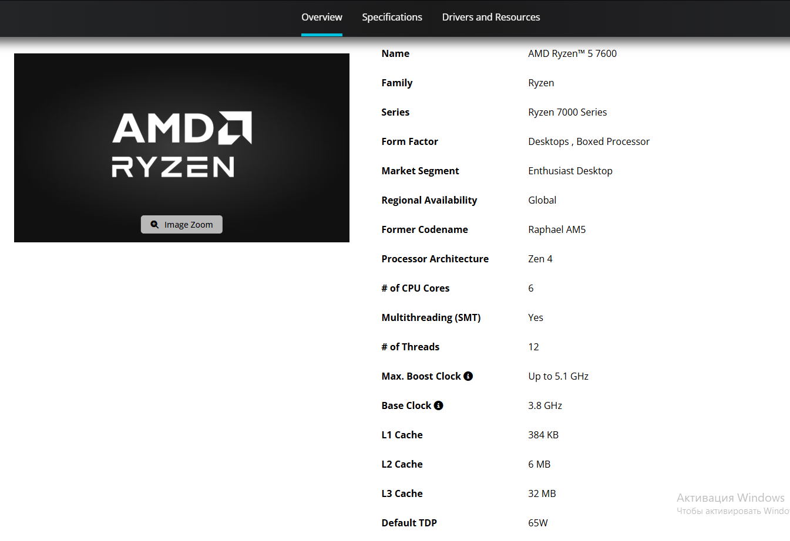
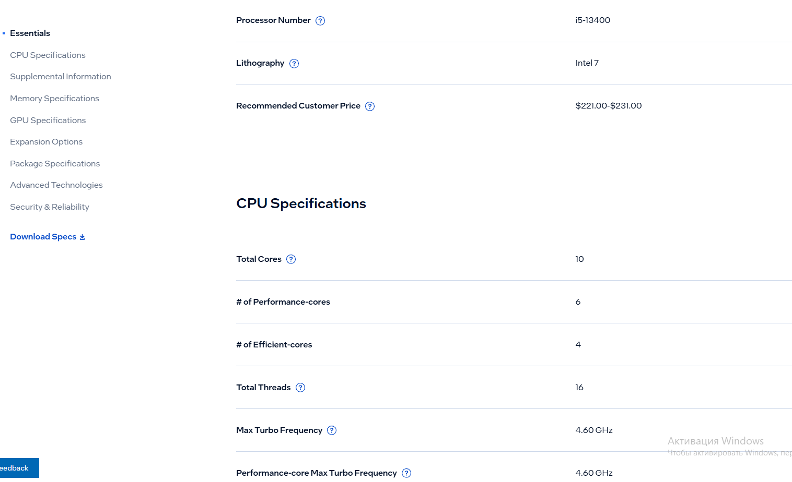
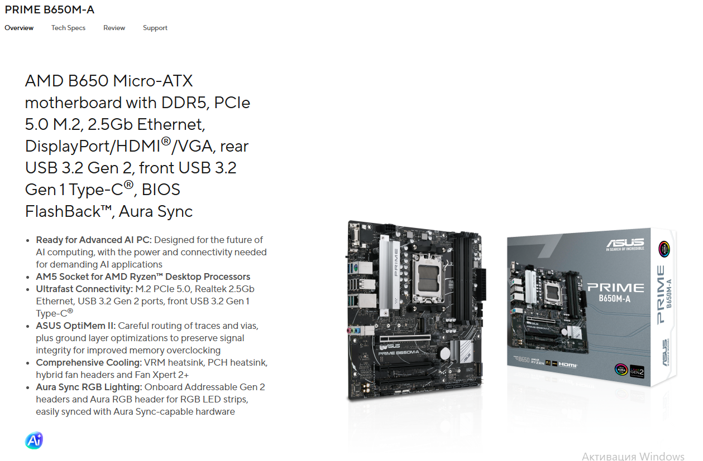
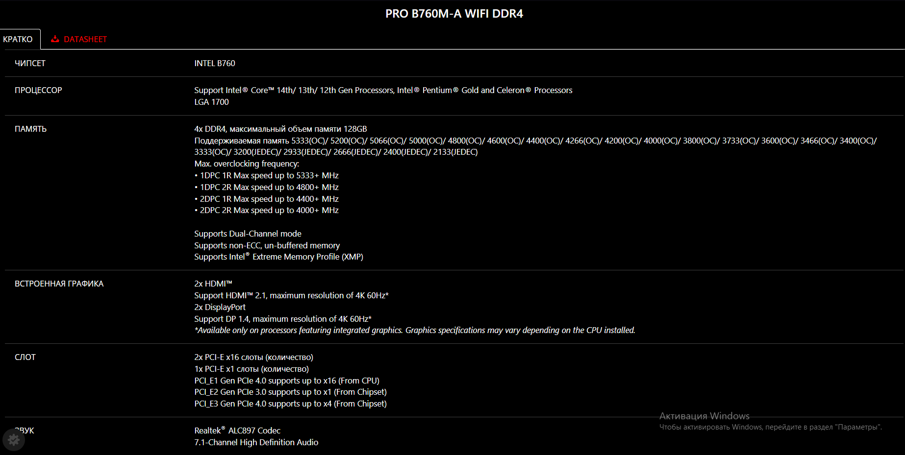
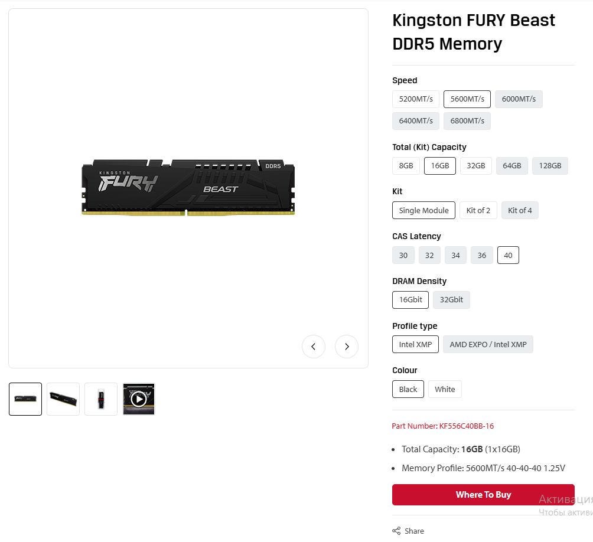
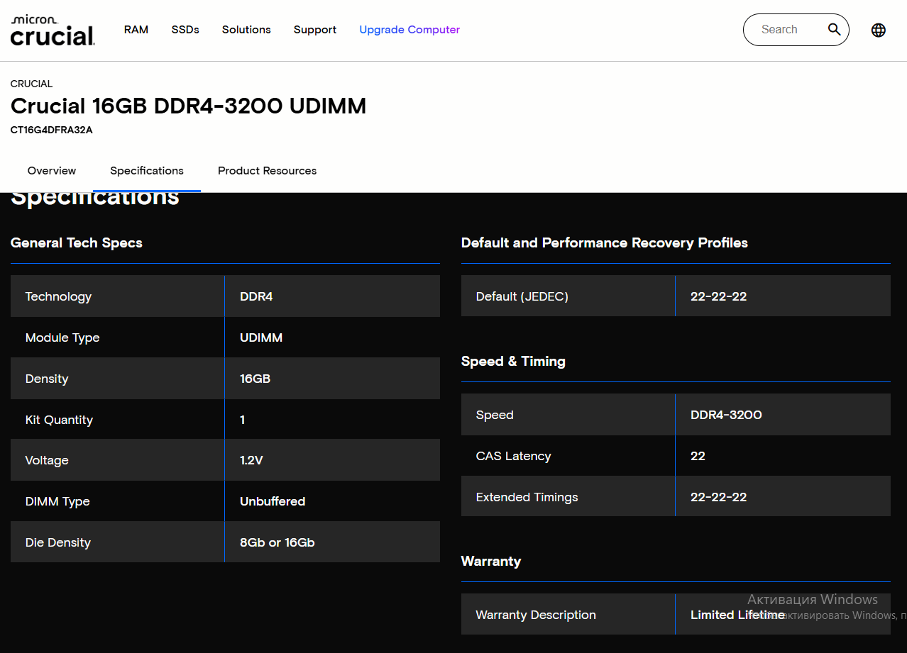
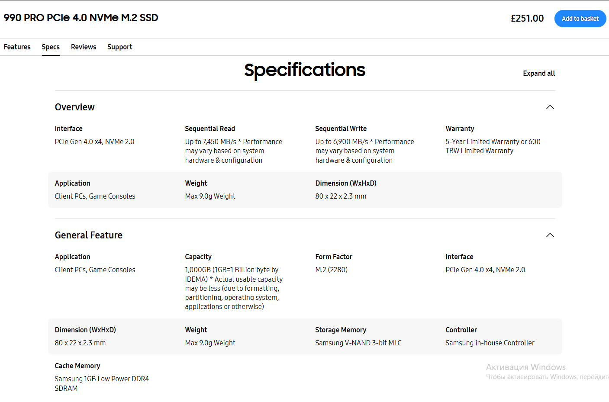
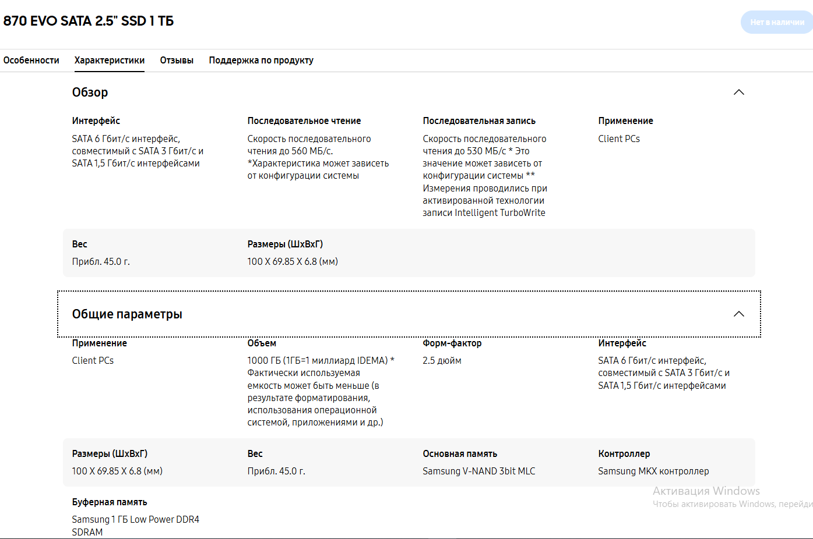
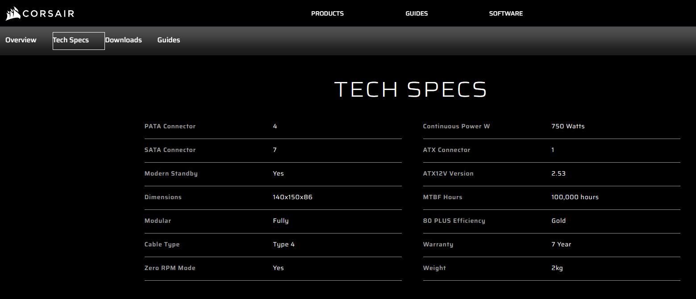
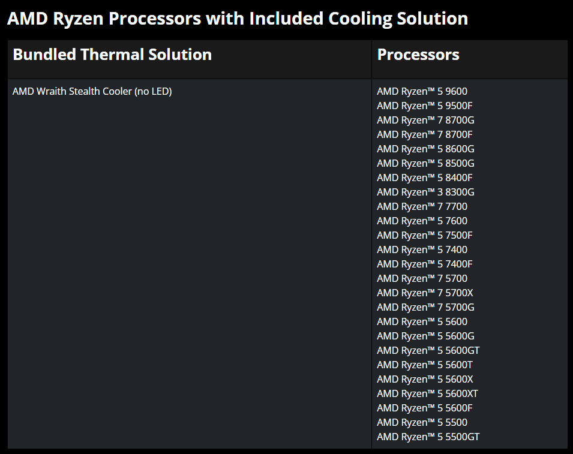

# Lab 3 — Teardown, and the same machine from the command line

Pair: None · Driver first half: Tamerlan Shakenov · Date: 08.11.2026  
Machine: HP Victus 16-e0xxx laptop (AMD Ryzen 7 5800H, 2 × 16 GB DDR4-3200 SO-DIMM, Samsung MZVLB1T0HBLR NVMe), Windows 10 Pro as host. Linux: Ubuntu Server 26.04.1 LTS as a guest in VMware Workstation Pro on the same laptop.

Facts below come from the makers' own pages (links under every part), not from shops.

---

## Part 1 — Ten parts

### 1. AMD Ryzen 5 7600

Desktop CPU, Zen 4 ("Raphael"), 6 cores / 12 threads, 3.8 GHz base, up to 5.1 GHz boost, 32 MB L3, 65 W default TDP, with a 2-core Radeon iGPU. Connects to **socket AM5** and to a dual-channel **DDR5** controller (UDIMM); works with A620, B650, B650E, X670, X670E, X870, X870E, B840 and B850 chipsets. Limit: AM5 boards only and DDR5 only (no DDR4); official memory speed is DDR5-5200 with two modules and DDR5-3600 with four.

Source: https://www.amd.com/en/products/processors/desktops/ryzen/7000-series/amd-ryzen-5-7600.html

### 2. Intel Core i5-13400

Desktop CPU (Raptor Lake), 10 cores (6 P + 4 E) / 16 threads, up to 4.60 GHz, 20 MB Smart Cache, 65 W base power (148 W maximum turbo power), Intel UHD Graphics 730. Connects to **socket FCLGA1700** and a 2-channel memory controller that takes **either DDR5-4800 or DDR4-3200** — which one depends on the board. Limit: LGA1700 boards only (not AM5); the DIMM generation is fixed by the board's slots, so one board cannot mix DDR4 and DDR5.

Source: https://www.intel.com/content/www/us/en/products/sku/230495/intel-core-i513400-processor-20m-cache-up-to-4-60-ghz/specifications.html

### 3. ASUS PRIME B650M-A

Micro-ATX board, **socket AM5**, **AMD B650** chipset, 4 × DIMM **DDR5** (4800 / 5000 / 5200 native, 5400 and 5600 only as overclock), dual channel, ECC and non-ECC unbuffered, AMD EXPO support. Storage: two M.2 slots (one with PCIe 5.0 support, M.2_2 is PCIe 4.0 x4) and 4 × SATA 6 Gb/s. CPU support: AMD Ryzen 9000, 8000 and 7000 series. Limit: DDR5 only; the PCIe 5.0 M.2 slot works only with 7000/9000 CPUs; an older BIOS may need a flash for newer CPUs (see CPU Support list).

Source: https://www.asus.com/motherboards-components/motherboards/prime/prime-b650m-a/techspec/

### 4. MSI PRO B760M-A WIFI DDR4

Micro-ATX board, **socket LGA1700**, **Intel B760** chipset, 4 × **DDR4** DIMM (up to 128 GB, dual channel, JEDEC 3200, XMP / overclock up to 5333), 2 × M.2, PCI_E1 is PCIe 4.0 x16 from the CPU, 2 × HDMI and 2 × DisplayPort for the CPU's iGPU. CPU support: Intel Core 14th / 13th / 12th Gen, Pentium Gold, Celeron (14th Gen needs a newer BIOS — see CPU Support list). Limit: DDR4 only (a DDR5 module physically does not fit); video outputs work only with a CPU that has integrated graphics (not "F" models).

Source: https://www.msi.com/Motherboard/PRO-B760M-A-WIFI-DDR4

### 5. Kingston FURY Beast DDR5-5600, 16 GB (KF556C40BB-16)

DDR5 UDIMM, 16 GB single module, 288-pin, non-ECC unbuffered, 1Rx8, 5600 MT/s CL40-40-40 at 1.25 V (Intel XMP 3.0 profile); factory JEDEC default is DDR5-4800 CL40-39-39 at 1.1 V. Connects to a DDR5 DIMM slot, one module per channel. Limit: DDR5 boards only; 5600 MT/s runs only if the XMP profile is enabled; the profile is XMP, not AMD EXPO, so on an AM5 board it may run at 4800 until the profile is loaded; one module = single-channel.

Source: https://www.kingston.com/en/memory/search?partid=KF556C40BB-16 · datasheet https://www.kingston.com/datasheets/KF556C40BB-16.pdf

### 6. Crucial DDR4-3200, 16 GB UDIMM (CT16G4DFRA32A)

DDR4 UDIMM, 16 GB single module, 3200 MT/s, CL22, 1.2 V, unbuffered, JEDEC default 22-22-22, limited lifetime warranty; the maker marks the product page as end-of-life (EOL). Connects to a DDR4 DIMM slot, one per channel. Limit: DDR4 boards only (the notch is in a different place from DDR5); no XMP profile, it runs at the JEDEC speed; one module = single-channel.

Source: https://www.crucial.com/memory/ddr4/ct16g4dfra32a

### 7. Samsung 990 PRO 1 TB

M.2 2280 NVMe SSD, PCIe Gen 4.0 x4, NVMe 2.0, up to 7,450 MB/s read and 6,900 MB/s write, 80 × 22 × 2.3 mm, max 9 g, 1 GB LPDDR4 cache, 5-year or 600 TBW warranty. Connects directly to an M.2 (M key) slot, no cables. Limit: needs an M.2 slot with NVMe; it is a PCIe 4.0 drive, so in a PCIe 5.0 slot it still runs at 4.0 speed; this version has no heatsink.

Source: https://www.samsung.com/uk/memory-storage/nvme-ssd/990-pro-1tb-nvme-pcie-gen-4-mz-v9p1t0bw/

### 8. Samsung 870 EVO 1 TB

2.5-inch SATA SSD, SATA 6 Gb/s (also works at 3 Gb/s and 1.5 Gb/s), up to 560 MB/s read and 530 MB/s write, 100 × 69.85 × 6.8 mm, about 45 g, Samsung MKX controller, 1 GB LPDDR4 cache, 5-year or 600 TBW warranty. Connects to a SATA port with a SATA data cable plus a SATA power cable from the PSU, and needs a 2.5" bay in the case. Limit: the SATA bus caps it near 560 MB/s, roughly 13 times slower than the 990 PRO's read speed; "1 TB" is 1,000 GB, so the OS shows less.

Source: https://www.samsung.com/kz_ru/memory-storage/sata-ssd/870-evo-1tb-sata-3-2-5-ssd-mz-77e1t0bw/

### 9. Corsair RM750e (750 W)

ATX power supply, 750 W continuous (62.5 A on +12 V), fully modular, 80 PLUS Gold, Zero RPM fan mode, 7-year warranty, about 2 kg. Maker's current page lists ATX12V 3.1; the screenshot shows an older revision (ATX12V 2.53, 7 SATA, 4 PATA connectors). Connects to the board's 24-pin ATX and CPU 8-pin connectors, to drives by SATA power cables, and to a graphics card by PCIe cables. Limit: one unit for two computers; it needs an ATX-size slot in the case (140 × 150 × 86 mm).

Source: https://www.corsair.com/us/en/p/psu/cp-9020262-na/rme-series-rm750e-fully-modular-low-noise-atx-power-supply-cp-9020262-na

### 10. Stock cooler — AMD Wraith Stealth (comes with the Ryzen 5 7600)

Air cooler (no LED) bundled with the Ryzen 5 7600 — AMD's page lists "Thermal Solution (PIB): AMD Wraith Stealth" for it, and AMD's table of bundled coolers lists the 7600 among the processors that include it. Connects to the processor's socket (AM5) with a fan cable to the board's CPU fan header. Limit: sized for 65 W-class CPUs, so it is not meant for overclocking; it only comes with the listed Ryzen models. The Ryzen 5 7600 has a Tjmax of 95 °C. Note: the boxed Core i5-13400 also ships a cooler, the Intel Laminar RM1 (aluminium fins, copper base, up to 47 mm high, 100 × 100 mm) — Intel's article lists the i5-13400 among the processors that include it. Build 2 therefore has its own box cooler.

Sources: https://www.amd.com/en/products/processors/desktops/ryzen/7000-series/amd-ryzen-5-7600.html · https://www.intel.com/content/www/us/en/support/articles/000089190.html

---

## Motherboards: socket, chipset, memory

| | ASUS PRIME B650M-A | MSI PRO B760M-A WIFI DDR4 |
|---|---|---|
| Socket | AM5 | LGA1700 |
| Chipset | AMD B650 | Intel B760 |
| Memory | 4 × DDR5 DIMM, 4800–5200 native, 5400/5600 OC | 4 × DDR4 DIMM, JEDEC 3200, up to 5333 OC |
| Form factor | Micro-ATX | Micro-ATX |
| Storage | 2 × M.2 (one PCIe 5.0), 4 × SATA | 2 × M.2, SATA ports |
| CPU generations | Ryzen 9000, 8000, 7000 | Core 14th, 13th, 12th Gen; Pentium Gold; Celeron |

---

## Two builds

### Build 1 — AMD, DDR5

| Part | Model | Why it fits here |
|---|---|---|
| CPU | AMD Ryzen 5 7600 | Socket AM5 and DDR5 only; the ASUS board is the only AM5 board in the list. |
| Motherboard | ASUS PRIME B650M-A | Socket AM5, B650, 4 DDR5 slots, lists Ryzen 7000 as supported. |
| Memory | Kingston FURY Beast DDR5-5600 16 GB | DDR5 module; only this board has DDR5 slots. Runs at 5600 only through its profile; 4800 by default. |
| SSD | Samsung 990 PRO 1 TB | NVMe M.2 2280 fits the board's M.2 slot, no cables; the board's PCIe 5.0 slot is backwards-compatible with a PCIe 4.0 drive. |
| Cooler | AMD Wraith Stealth | Ships in the Ryzen 5 7600 box. |
| PSU | Corsair RM750e | Has the 24-pin and CPU 8-pin the board needs; 750 W is far above a 65 W CPU with no graphics card. |

**Still needs:** a case (Micro-ATX), keyboard, mouse and a monitor (the board has HDMI/DisplayPort/VGA, the 7600 has integrated graphics, so no graphics card is required), an operating system, and a second memory module if dual-channel is wanted (one module = single-channel).

### Build 2 — Intel, DDR4

| Part | Model | Why it fits here |
|---|---|---|
| CPU | Intel Core i5-13400 | LGA1700; its controller supports DDR4-3200, matching this board. |
| Motherboard | MSI PRO B760M-A WIFI DDR4 | LGA1700, lists 13th Gen as supported, 4 DDR4 slots. |
| Memory | Crucial DDR4-3200 16 GB | DDR4 module for the DDR4-only board; 3200 MT/s equals the CPU's DDR4 maximum. |
| SSD | Samsung 870 EVO 1 TB | SATA drive; the board has SATA ports, and it is the part that does not need an M.2 slot. |
| Cooler | Intel Laminar RM1 (in the i5-13400 box, not one of the ten parts) | The boxed processor includes it, so no extra cooler is needed. |
| PSU | none left | The list has one RM750e and it is used in Build 1. |

**Still needs:** a **second power supply** (the only RM750e went to Build 1), a case (Micro-ATX), a SATA data cable for the 870 EVO plus a SATA power cable from the new PSU, keyboard, mouse and monitor (board has HDMI/DisplayPort, the CPU has UHD 730), an operating system, and a second memory module for dual-channel.

Both builds are Micro-ATX, have no graphics card, and use one module of RAM. The two SSDs could be swapped between builds: both boards have M.2 and SATA.

---

## Part 2 — Same facts, three operating systems

| Fact | Windows (PowerShell) | Linux (Ubuntu VM) | macOS |
|---|---|---|---|
| CPU model | `Get-CimInstance Win32_Processor \| Select Name` | `lscpu` (Model name) | `sysctl -n machdep.cpu.brand_string` |
| Cores / threads | `Get-CimInstance Win32_Processor \| Select NumberOfCores, NumberOfLogicalProcessors` | `lscpu` (CPU(s), Thread(s) per core, Core(s) per socket) | `sysctl hw.physicalcpu hw.logicalcpu` |
| Total memory | `(Get-CimInstance Win32_ComputerSystem).TotalPhysicalMemory` | `free -h` | `sysctl hw.memsize` |
| Memory modules and speed | `Get-CimInstance Win32_PhysicalMemory \| Select DeviceLocator, Capacity, Speed, ConfiguredClockSpeed, SMBIOSMemoryType, FormFactor` | `sudo dmidecode -t memory` | `system_profiler SPMemoryDataType` |
| Disk model and type | `Get-PhysicalDisk \| Select FriendlyName, MediaType, BusType, Size` | `lsblk -d -o NAME,MODEL,ROTA,TRAN,SIZE` | `diskutil info disk0` |
| Free space | `Get-Volume C` | `df -h /` | `df -h /` |
| Architecture | `$env:PROCESSOR_ARCHITECTURE` | `uname -m` | `uname -m` |

macOS column: I have no Mac, so these commands were not run and there is no `macos-specs.txt`; the commands are taken from the lab guide.

**What Windows showed (host, `evidence/windows-specs.txt`):** The processor is an AMD Ryzen 7 5800H with Radeon Graphics: 8 cores / 16 threads. `MaxClockSpeed` shows 3201 MHz, which is the base clock, not the boost clock. The memory is two modules of 17,179,869,184 bytes (16 GiB each) at 3200 MT/s, with `SMBIOSMemoryType 26` (DDR4) and `FormFactor 12` (SO-DIMM), so the host is a laptop with DDR4 SO-DIMMs, not a desktop with the UDIMMs from Part 1. `TotalPhysicalMemory` is 33,659,625,472 bytes (31.35 GiB), a little less than the 32 GiB of the two modules, probably because some memory is reserved for the integrated graphics. The disk is a Samsung MZVLB1T0HBLR, NVMe, `MediaType SSD`, 1,024,209,543,168 bytes. Windows shows volume C: as 953.14 GB with 273.91 GB free; the maker counts in billions of bytes, the OS in powers of 1024, and C: is slightly smaller than the whole disk. Architecture is `AMD64`.

**How the names differ between systems:** Windows returns numeric codes for memory (type 26, form factor 12) and raw bytes, Linux prints human-readable text in `dmidecode` and `free -h`, and the architecture is called `AMD64` on Windows but `x86_64` on Linux for the same instruction set.

**What the VM showed differently from the host:** `lscpu` shows 4 CPUs with 1 thread per core, while the host has 8 cores / 16 threads, and `free -h` shows 7.2 GiB instead of the host's 31.35 GiB. These are only the resources I gave to the VM (a quarter of the threads, 8 GB of RAM). `lsblk` shows a virtual disk `sda` ("VMware Virtual S", 25 G, `ROTA 1`) instead of the Samsung NVMe SSD, so the VM claims a spinning disk and hides the real drive type; `df -h /` shows a 12G root volume with 7.6G free, not the 273.91 GB free on C:. `dmidecode` lists 128 virtual "RAM slot" entries and only one has a module: 8 GB, form factor DIMM, type DRAM, speed Unknown, so the real two 16 GB DDR4-3200 SO-DIMMs are hidden. VMware does pass through the CPU name (AMD Ryzen 7 5800H), the instruction flags (avx2, aes, sha_ni), the cache sizes (L3 16 MiB) and the architecture (`x86_64`, called `AMD64` on Windows). `systemd-detect-virt` prints `vmware`, so everything in `linux-specs.txt` describes the virtual machine, not the laptop.

---

## What did not work the first time

1. My first screenshots were of the wrong variants of three parts: the Kingston page showed the 8 GB 5200 MT/s module (KF552C40BB-8) instead of the 16 GB 5600 MT/s one, the Crucial page showed 8 GB (CT8G4DFRA32A) instead of 16 GB, and the Samsung 870 EVO page showed 250 GB instead of 1 TB. I noticed when I compared each screenshot against the lab's part list. I reopened the pages, selected the 16 GB / 5600 MT/s / 1 TB options and replaced the files.
2. My first `windows-specs.txt` had no output for the processor command and no command written above each block, so it could not be read as evidence. I re-ran all commands with a PowerShell script that writes the command line first and its output after it.

---

## Evidence

- [evidence/windows-specs.txt](evidence/windows-specs.txt) — raw PowerShell output (CPU, memory modules, disk, volume C:, architecture) from the Windows 10 host, each command above its output.
- [evidence/linux-specs.txt](evidence/linux-specs.txt) — raw output of `lscpu`, `free -h`, `dmidecode`, `lsblk`, `df`, `uname -m` from the Ubuntu Server VM in VMware Workstation Pro, collected over SSH; it describes the virtual machine.
- [evidence/photos/](evidence/photos/) — screenshots of the ten makers' pages, one file per part (`ryzen5-7600.png`, `i5-13400.png`, `asus-b650m-a.png`, `msi-b760m-d2.png`, `kingston-ddr5.png`, `crucial-ddr4.png`, `samsung-990pro.png`, `samsung-870evo.png`, `corsair-rm750e.png`, `stock-cooler.png`).