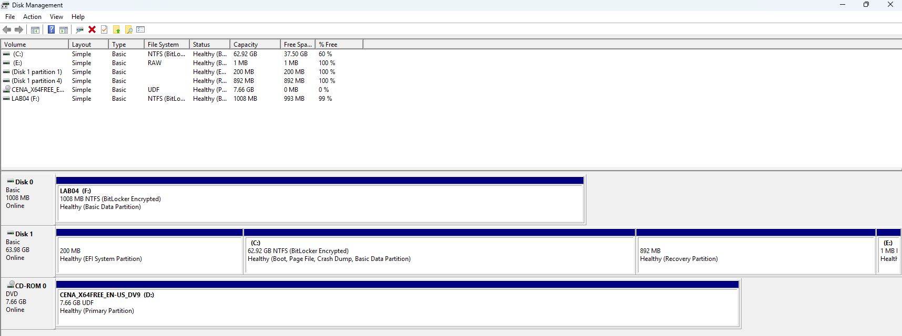

# Lab 4 - Partition, mirror, fail, recover

Pair: None · Driver first half: Tamerlan Shakenov  
Date: 15.11.2026  
Machine: HP Victus 16-e0xxx laptop (AMD Ryzen 7 5800H, 2 × 16 GB DDR4-3200 SO-DIMM, Samsung MZVLB1T0HBLR NVMe 1 TB), Windows 10 Pro as host. Guests: Ubuntu Server 26.04.1 LTS and Windows 11 Evaluation running in VMware Workstation Pro.

## Windows

```
Number FriendlyName                   PartitionStyle        Size
------ ------------                   --------------        ----
     1 VMware Virtual NVMe Disk       GPT            68719476736
     0 VMware Virtual SATA Hard Drive GPT             1073741824
```

```
DriveLetter FriendlyName FileSystemType DriveType HealthStatus OperationalStatus SizeRemaining       Size
----------- ------------ -------------- --------- ------------ ----------------- -------------       ----
F           LAB04        NTFS           Fixed     Healthy      OK                    993.06 MB 1007.93 MB
```



MBR or GPT: GPT was chosen. Windows 11 Evaluation boots in UEFI mode, which requires a GPT partition table. GPT also keeps a backup copy of the partition table and protects it with checksums. MBR is limited to 2 TiB and only four primary partitions.

## Linux - layout before and after

### Before
```
NAME                       SIZE TYPE FSTYPE      MOUNTPOINTS
loop0                     66.8M loop squashfs    /snap/core24/1643
loop1                      1.5M loop squashfs    /snap/hwctl/131
loop2                      1.5M loop squashfs    /snap/hwctl/123
loop3                     50.1M loop squashfs    /snap/snapd/27710
sda                         25G disk
├─sda1                       1M part
├─sda2                       2G part ext4        /boot
└─sda3                      23G part LVM2_member
  └─ubuntu--vg-ubuntu--lv 11.5G lvm  ext4        /
sdb                          1G disk
sdc                          1G disk
sdd                          1G disk
sr0                        2.7G rom  iso9660
```

### After
```
NAME                       SIZE TYPE  FSTYPE            MOUNTPOINTS
loop0                     66.8M loop  squashfs          /snap/core24/1643
loop1                      1.5M loop  squashfs          /snap/hwctl/131
loop2                      1.5M loop  squashfs          /snap/hwctl/123
loop3                     50.1M loop  squashfs          /snap/snapd/27710
sda                         25G disk
├─sda1                       1M part
├─sda2                       2G part  ext4              /boot
└─sda3                      23G part  LVM2_member
  └─ubuntu--vg-ubuntu--lv 11.5G lvm   ext4              /
sdb                          1G disk
└─sdb1                    1022M part  linux_raid_member
  └─md0                   1021M raid1 ext4              /mnt/mirror
sdc                          1G disk
└─sdc1                    1022M part  linux_raid_member
sdd                          1G disk
└─sdd1                    1022M part  linux_raid_member
  └─md0                   1021M raid1 ext4              /mnt/mirror
sr0                        2.7G rom   iso9660
```

## What I did

```bash
# Partition the three disks and mark them for RAID
for d in sdb sdc sdd; do
  sudo parted -s /dev/$d mklabel gpt mkpart primary 1MiB 100% set 1 raid on
done

# Create RAID 1 mirror from the first two disks
sudo mdadm --create /dev/md0 --level=1 --raid-devices=2 /dev/sdb1 /dev/sdc1

# Create filesystem, mount and take ownership
sudo mkfs.ext4 -L mirror /dev/md0
sudo mkdir -p /mnt/mirror
sudo mount /dev/md0 /mnt/mirror
sudo chown $USER: /mnt/mirror

# Write proof files and record checksums
echo "Lab 4 proof file — Tamerlan Shakenov — $(date)" > /mnt/mirror/proof.txt
head -c 20M /dev/urandom > /mnt/mirror/random.bin
sha256sum proof.txt random.bin

# Intentionally fail one disk
sudo mdadm /dev/md0 --fail /dev/sdc1
sudo mdadm /dev/md0 --remove /dev/sdc1

# Verify the data is still readable and checksums still match
sha256sum proof.txt random.bin

# Add the third disk and let the array rebuild
sudo mdadm /dev/md0 --add /dev/sdd1
```

## Three states

| State    | What /proc/mdstat showed               | File |
|----------|----------------------------------------|------|
| Healthy  | [2/2] [UU]                             | [evidence/array-healthy.txt](evidence/array-healthy.txt) |
| Degraded | [2/1] [U_]                             | [evidence/array-degraded.txt](evidence/array-degraded.txt) |
| Rebuilt  | [2/2] [UU], sdd1 replaced sdc1         | [evidence/array-rebuilt.txt](evidence/array-rebuilt.txt) |

Checksums before and after the failure: **match**  
- [evidence/checksum-before.txt](evidence/checksum-before.txt)  
- [evidence/checksum-after-failure.txt](evidence/checksum-after-failure.txt)

## RAID is not a backup

Your colleague deleted the wrong file from the mirror an hour ago. Does RAID 1 help? Why?

RAID 1 does not help. A mirror keeps two identical copies of every block, so when a file is deleted the deletion is written to both disks at the same time. RAID 1 only protects against the failure of a physical disk; it does not protect against human error or accidental deletion.

## What did not work the first time

When I first ran `Get-Disk` on the Windows guest I selected Disk 1 (the 64 GB system disk) instead of the newly added 1 GB disk. The command failed with “The disk has already been initialized”. After re-checking the output I correctly identified Disk 0 (RAW, 1 GB), initialized it as GPT and formatted it successfully.

## Evidence

- [evidence/lsblk-before.txt](evidence/lsblk-before.txt) - disk layout before any changes
- [evidence/array-healthy.txt](evidence/array-healthy.txt) - RAID 1 in clean state with two active devices
- [evidence/array-degraded.txt](evidence/array-degraded.txt) - RAID 1 after one disk was failed
- [evidence/checksum-before.txt](evidence/checksum-before.txt) - SHA-256 checksums of the proof files before failure
- [evidence/checksum-after-failure.txt](evidence/checksum-after-failure.txt) - SHA-256 checksums after failure (identical)
- [evidence/array-rebuilt.txt](evidence/array-rebuilt.txt) - RAID 1 after the third disk was added and rebuild finished
- [evidence/disk-management.png](evidence/disk-management.png) - Windows Disk Management showing the LAB04 volume
