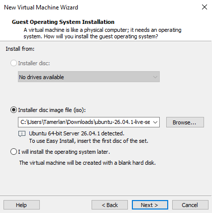
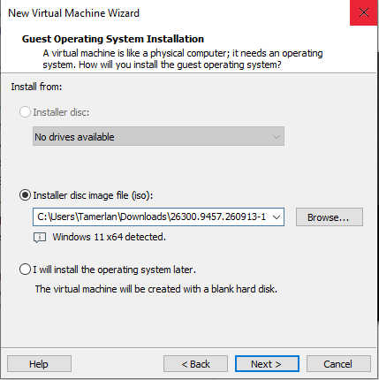
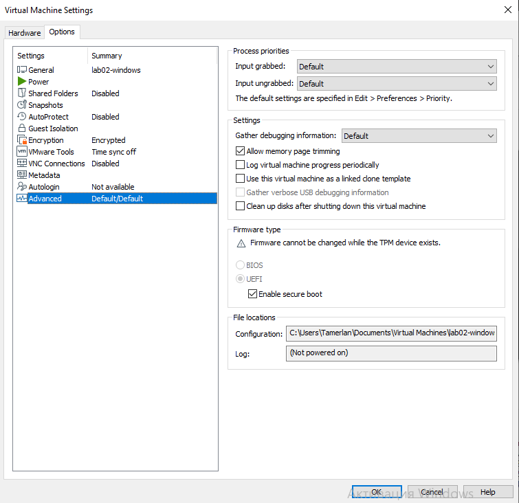
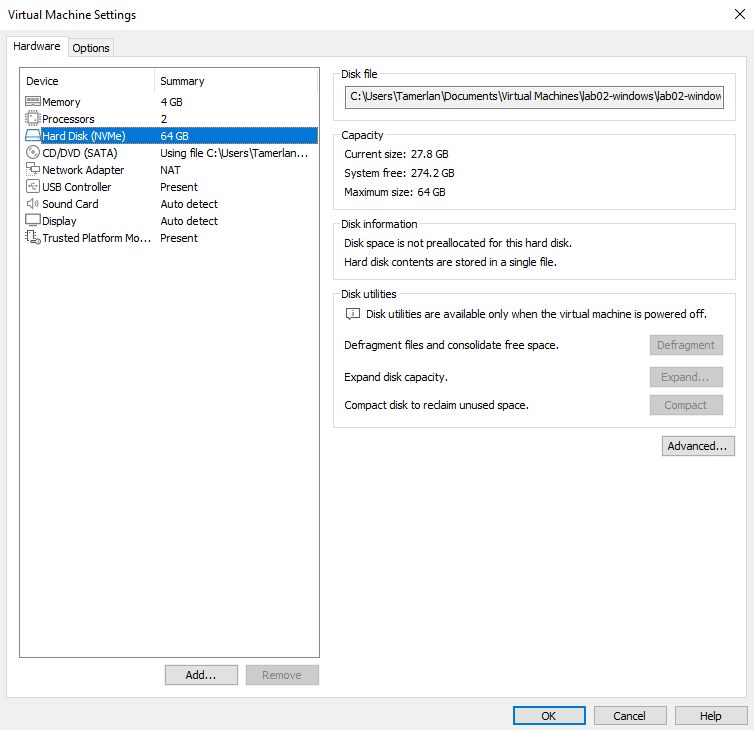
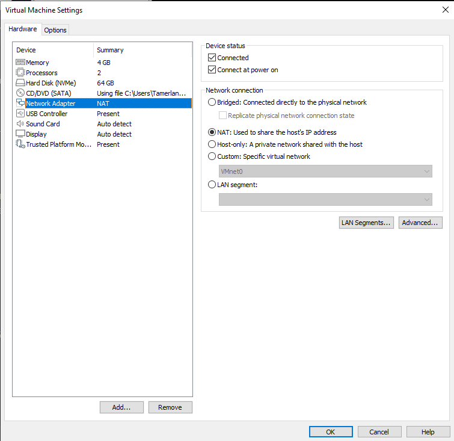
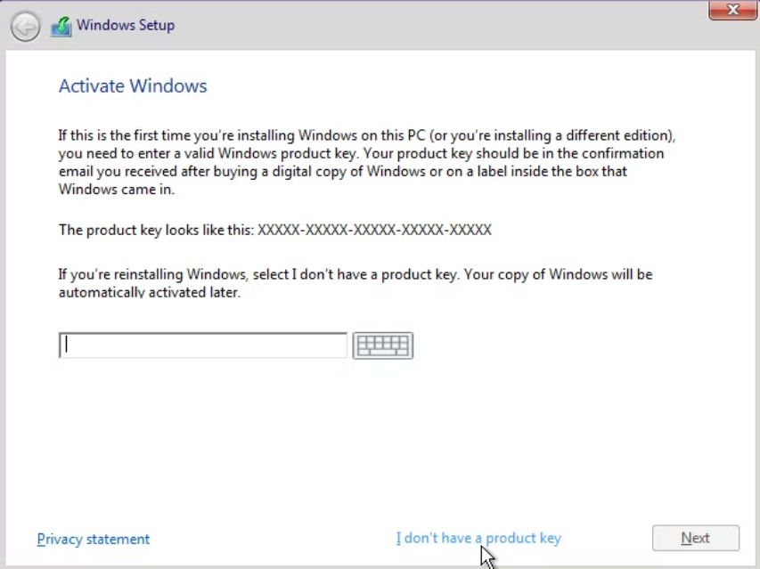
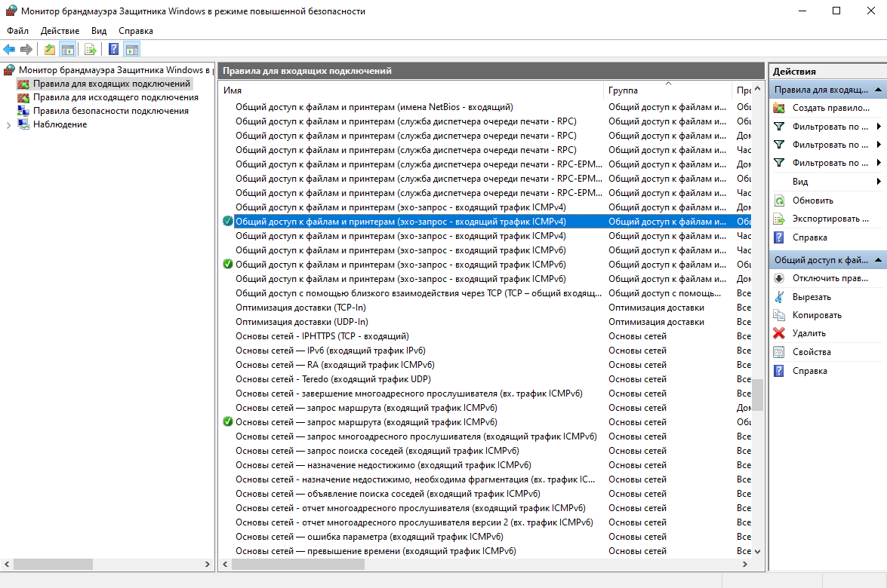
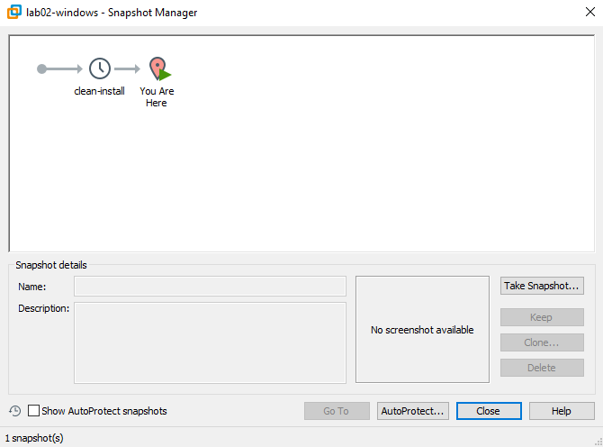

# VMware Workstation Build Document

This guide is written for a non-technical reader. Follow the steps exactly. Do not skip screenshots or commands.

The goal is a twin-sandbox test environment:
- `lab01-ubuntu` — Ubuntu Server LTS
- `lab02-windows` — Windows 11 Enterprise Evaluation (90-day)

Both machines must be able to reach the internet and ping each other. Clean baseline snapshots must exist so the environment can be restored after experiments.

---

## Step 0: Prerequisites & Software Installation

### 1. Install the Hypervisor (VMware Workstation Pro)

VMware Workstation Pro is free for personal, educational and commercial use (no licence key required).

1. Go to the official Broadcom download page for VMware Workstation Pro:  
   https://support.broadcom.com/group/ecx/productdownloads?subfamily=VMware%20Workstation%20Pro  
   (You will need a free Broadcom account. After login, download the latest Windows or Linux installer.)
2. Run the downloaded installer.
3. Accept the licence agreement, keep the default installation path, and finish the wizard.
4. Restart the host computer if the installer asks you to.

### 2. Download the Operating System ISO Images

Create a folder called `ISOs` on your hard drive and put both files there. **Do not open or extract the ISO files.**

* **Ubuntu Server LTS (64-bit):**  
  https://ubuntu.com/download/server  
  Download the latest LTS live-server ISO.

* **Windows 11 Enterprise Evaluation (64-bit):**  
  https://www.microsoft.com/en-us/evalcenter/download-windows-11-enterprise  
  Register with a Microsoft account if asked, then download the 64-bit ISO. This is a free 90-day fully-featured evaluation.

---

## Step 1: Create the Virtual Machines

### Create lab01-ubuntu

1. Open VMware Workstation.
2. Click **Create a New Virtual Machine** (or press `Ctrl+N`).
3. Choose **Typical (recommended)** → Next.
4. Select **Installer disc image file (iso)** → Browse → choose the Ubuntu Server ISO → Next.
5. Name the virtual machine `lab01-ubuntu`.
6. Set the location if you want, then click Next.
7. Set maximum disk size to **25 GB** and select **Store virtual disk as a single file**. Keep thin provisioning (default in most versions).
8. Click **Customize Hardware**:
   - Memory: **8192 MB** (8 GB)
   - Processors: **4**
   - Network Adapter: leave as NAT for now (we will confirm later)
9. Click Finish.



*What this shows:* New Virtual Machine Wizard with the Ubuntu Server ISO selected and the name `lab01-ubuntu`.

### Create lab02-windows

1. Click **Create a New Virtual Machine** again (`Ctrl+N`).
2. Choose **Typical (recommended)** → Next.
3. Select **Installer disc image file (iso)** → Browse → choose the Windows 11 Enterprise Evaluation ISO → Next.
4. Name the virtual machine `lab02-windows`.
5. Set maximum disk size to **64 GB** and select **Store virtual disk as a single file**.
6. Click **Customize Hardware**:
   - Memory: **4096 MB** (4 GB)
   - Processors: **2**
7. Click Finish.



*What this shows:* New Virtual Machine Wizard with the Windows 11 Enterprise Evaluation ISO selected and the name `lab02-windows`.

### Configure UEFI and vTPM for Windows 11 (required)

Windows 11 will not install correctly without UEFI and a virtual Trusted Platform Module.

1. Select `lab02-windows` → **Edit virtual machine settings**.
2. Go to the **Options** tab → **Advanced**.
3. Set Firmware type to **UEFI** (not BIOS).
4. Enable **Secure Boot** if the option is available.
5. Go back to the **Hardware** tab → **Add** → **Trusted Platform Module** → Finish.
6. Click OK to save.



*What this shows:* Options → Advanced with UEFI selected, and Hardware list showing Trusted Platform Module added.

### Confirm disk settings

1. In the settings of each VM, open **Hardware → Hard Disk**.
2. Verify the sizes:
   - `lab01-ubuntu` → 25 GB
   - `lab02-windows` → 64 GB



*What this shows:* Virtual disk size configuration for the Windows guest (64 GB) and confirmation of thin provisioning.

---

## Step 2: Networking Configuration

1. Select each virtual machine → **Edit virtual machine settings**.
2. Select **Network Adapter**.
3. Choose **NAT: Used to share the host’s IP address**.
4. Click OK.

Do this for **both** virtual machines.



*What this shows:* Network Adapter set to NAT.

**Why NAT?**  
The campus network filters devices by physical MAC address. Bridged mode would make the VM appear as a new unknown device and internet would be blocked. NAT makes the guests share the host’s already-authorised IP and MAC address.

---

## Step 3: Install the Operating Systems

### Install Ubuntu Server (lab01-ubuntu)

1. Power on `lab01-ubuntu`.
2. Select your language → Continue.
3. Choose the Ubuntu Server installer.
4. Keyboard layout → Done.
5. Network: leave the default (DHCP via NAT) → Done.
6. Proxy: leave empty → Done.
7. Mirror: leave default → Done.
8. Storage: use the entire disk (the 25 GB virtual disk) → Done → Continue.
9. Profile setup: create a user (remember the username and password).
10. SSH: install OpenSSH server (recommended).
11. Featured snaps: you can skip or install what you need.
12. Wait for installation to finish → Reboot.
13. Log in with the user you created.

### Install Windows 11 (lab02-windows)

1. Power on `lab02-windows`.
2. Choose language, time and keyboard → Next → Install now.
3. When asked for a product key, choose **I don’t have a product key** (evaluation).



*What this shows:* Windows Setup screen where “I don’t have a product key” is selected.

4. Select **Windows 11 Enterprise Evaluation**.
5. Accept the licence terms.
6. Choose **Custom: Install Windows only**.
7. Select the 64 GB virtual disk → Next.
8. Wait for installation and several automatic reboots.
9. Complete the out-of-box experience (region, keyboard, network, Microsoft account or offline account if offered).
10. When you reach the desktop, the evaluation is active for 90 days.

---

## Step 4: Verify Connectivity

### 4.1 Find IP addresses

**On Ubuntu:**
```bash
ip a
```
Note the IP address of the interface that is not `lo` (usually starts with 192.168.x.x or 172.x.x.x).

**On Windows (PowerShell or Command Prompt):**
```cmd
ipconfig
```
Note the IPv4 address of the Ethernet adapter.

### 4.2 Test connectivity

From Ubuntu terminal:
```bash
# Ping Windows
ping -c 4 <WINDOWS_IP>

# Ping internet
ping -c 4 8.8.8.8
ping -c 4 google.com
```

From Windows (Command Prompt or PowerShell):
```cmd
ping -n 4 <UBUNTU_IP>
ping -n 4 8.8.8.8
ping -n 4 google.com
```

Expected result: 0% packet loss in all directions.

The full successful output is saved here:


*What this shows:* Bidirectional ping (Ubuntu ↔ Windows) and successful internet connectivity from both guests.

### 4.3 Fix Windows Firewall if needed

If Ubuntu cannot ping Windows (100% packet loss):

1. On Windows search for **Windows Defender Firewall with Advanced Security**.
2. Click **Inbound Rules**.
3. Find **File and Printer Sharing (Echo Request – ICMPv4-In)**.
4. Right-click → **Enable Rule**.
5. Re-test the ping from Ubuntu.



*What this shows:* The ICMPv4 Echo Request inbound rule enabled in Windows Defender Firewall.

---

## Step 5: Create Baseline Snapshots (Rollback)

1. Shut down both virtual machines cleanly (do not just power off).
2. In VMware, select a VM → **Snapshot** → **Take Snapshot**.
3. Name: `clean-baseline`  
   Description: `Fresh install, network working, before any testing`.
4. Repeat for the second VM.



*What this shows:* Snapshot Manager with the `clean-baseline` snapshot present.

**How to roll back later:**
1. Select the virtual machine.
2. **Snapshot** → **Snapshot Manager**.
3. Select `clean-baseline` → **Go to** → confirm.

This restores the machine to the exact state after installation in under a minute.

---

## Step 6: Final Verification Checklist

- [ ] Both VMs power on without errors
- [ ] Ubuntu shows correct kernel and release (`uname -a` and `lsb_release -a`)
- [ ] Windows 11 Evaluation is running (check Settings → System → About)
- [ ] Ubuntu can ping Windows
- [ ] Windows can ping Ubuntu
- [ ] Both can reach the internet (`ping 8.8.8.8`)
- [ ] Clean baseline snapshots exist for both machines

Evidence of Ubuntu guest identity:


*What this shows:* Full output of `uname -a` and `lsb_release -a` confirming the Ubuntu Server installation.

---

## Step 7: Peer Reproduction (planned)

A second person will later follow this exact guide on a different computer and record the result in `evidence/10-reproduction-log.txt`.  
Until that file exists, do not claim that peer reproduction has been completed.

---

## Quick Reference – Resource Summary

| Machine          | RAM   | vCPUs | Disk   | Network | Firmware / TPM      |
|------------------|-------|-------|--------|---------|---------------------|
| lab01-ubuntu     | 8 GB  | 4     | 25 GB  | NAT     | (default)           |
| lab02-windows    | 4 GB  | 2     | 64 GB  | NAT     | UEFI + vTPM enabled |
| Host remaining   | ~20 GB| ~10   | thin   | –       | –                   |

---

## Evidence file list (for easy reference)

| File | What it proves |
|------|----------------|
| `01a-new-vm-wizard-ubuntu.png` | New VM Wizard with Ubuntu ISO selected |
| `01b-new-vm-wizard-windows.png` | New VM Wizard with Windows 11 ISO selected |
| `02-uefi-tpm-settings.png` | UEFI firmware + Trusted Platform Module enabled |
| `03-disk-settings.png` | Virtual disk size (25 GB / 64 GB) |
| `04-network-adapter.png` | NAT network adapter selected |
| `05-windows-no-product-key.png` | Windows Setup – “I don’t have a product key” |
| `06-ping-between-guests.txt` | Bidirectional ping + internet connectivity |
| `07-firewall-icmp-rule.png` | ICMPv4 firewall rule enabled |
| `08-snapshot-list.png` | Baseline snapshot exists |
| `09-guest-uname.txt` | Ubuntu kernel and distribution confirmation |
| `10-reproduction-log.txt` | Peer reproduction (planned) |
