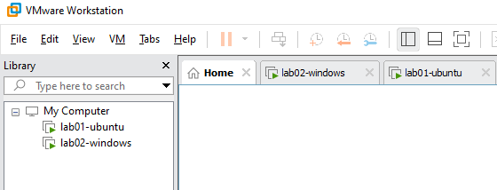
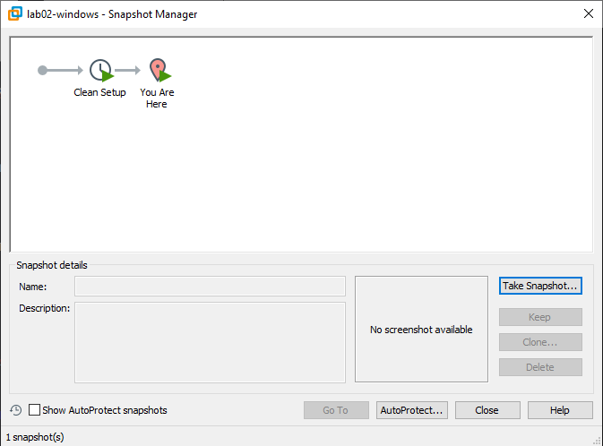

# VMware Workstation Build Document

This guide is designed for non-technical users to safely spin up a twin-sandbox test environment (Ubuntu Linux & Windows 11) using VMware Workstation.

## Step 1: Base Configuration
1. Open VMware Workstation and select **Create a New Virtual Machine**.
2. Choose your installer disc image (ISO) for Ubuntu Server or Windows 11.
3. Name the machines clearly: `lab01-ubuntu` and `lab02-windows`.
4. Allocate **8192 MB (8 GB) RAM** for the Ubuntu Server guest and **4096 MB (4 GB) RAM** for the Windows 11 guest.

## Step 2: Storage Allocation
1. Set the virtual disk size to **25 GB** for Ubuntu.
2. Set the virtual disk size to **64 GB** for Windows 11.

*Architectural Choice:* Windows 11 has strict storage requirements (minimum 64 GB) to handle system files, temporary storage, and cumulative Windows Updates comfortably without triggering system crashes. A desktop Ubuntu environment, however, operates efficiently within a tight 25 GB partition under typical development testing loads.

## Step 3: Networking Configuration
1. Open the virtual machine settings in VMware and select **Network Adapter**.
2. Strictly select the **NAT** (Network Address Translation) option.

*Why NAT and not Bridged:* The university teaching network filters connected devices strictly by physical MAC address. A bridged setup forces the virtual machine to broadcast its own unique MAC address to the local network switch, which results in an immediate internet lockout by the campus firewall. By using VMware's NAT engine, the guest machines share your host laptop's authorized IP and MAC address, gaining seamless internet access without network conflicts.

## Step 4: Environment Verification
1. Boot both machines to confirm they can reach the internet and see each other.
2. Take a system snapshot in VMware to save the clean state.
